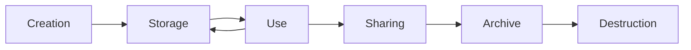

# 01 - Data Lifecycle

## Purpose
Map how data is created, stored, used, shared, archived, and destroyed in AWS, and attach the AWS service or control that protects each stage.

## Lifecycle Stages

| Stage | Description | AWS Services / Controls |
|---|---|---|
| Creation | Data is generated or collected | Application forms, RDS, Kinesis, Amazon Macie (discovery of sensitive data) |
| Storage | Data is persisted | S3, RDS, EBS with encryption at rest and classification tags |
| Use | Data is accessed and processed | IAM roles, S3 Access Points, VPC endpoints |
| Sharing | Data is exposed to other users or systems | Bucket policies, presigned URLs, Access Points, Block Public Access |
| Archive | Long-term retention at lower cost | S3 Standard-IA, S3 Glacier, Lifecycle rules |
| Destruction | Permanent and verified deletion | Lifecycle expiration, noncurrent version cleanup, KMS key deletion (Week 2) |

## Diagram

## Controls per Stage

### 1. Creation
- Classify data at the moment it is created.
- Use Amazon Macie to discover sensitive data that was not classified.
- Apply the `DataClassification` tag to the destination bucket.

### 2. Storage
- Enable default encryption on every bucket (SSE-S3 in Week 1, upgraded to SSE-KMS in Week 2).
- Enable versioning.
- Enable account-level Block Public Access.
- Tag every bucket: `DataClassification`, `Owner`, `Environment`.

### 3. Use
- Access only through IAM roles, following least privilege.
- Use S3 Access Points to give each application a scoped entry point.
- Enforce HTTPS only through a bucket policy (`aws:SecureTransport`).

### 4. Sharing
- Public access is blocked by default.
- Share through Access Points or presigned URLs with short expiry.
- Review external access with IAM Access Analyzer.

### 5. Archive
- Transition to S3 Standard-IA after 30 days and Glacier after 90 days.
- Archived data keeps the same classification and encryption.

### 6. Destruction
- Expire objects after the retention period (365 days in the lab).
- Delete noncurrent versions after 90 days.
- Abort incomplete multipart uploads after 7 days.
- Schedule KMS key deletion for retired keys (Week 2).

## Notes for Week 2
Encryption in this week is SSE-S3. Week 2 upgrades Confidential and Restricted buckets to SSE-KMS.
